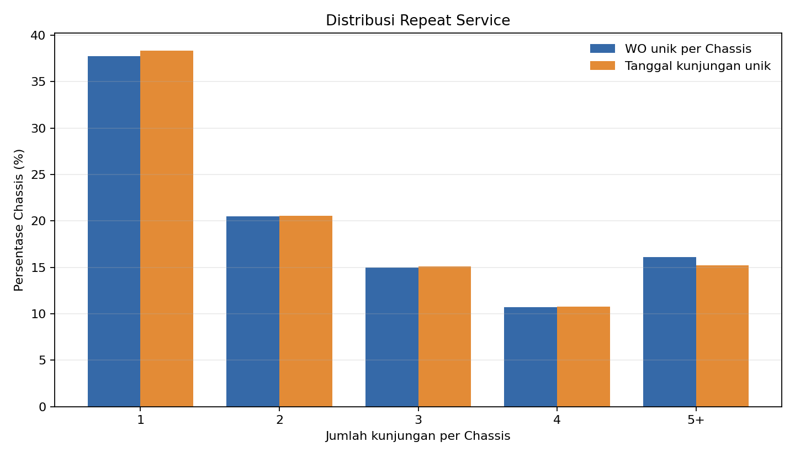

# Repeat Service Rate

## Pertanyaan

Berapa persen kendaraan (Chassis) yang servis lebih dari sekali?

## Data yang dipakai

Hanya `data/pkb_master.parquet`, dengan kolom `Chassis` dan `Tanggal_PKB`. Data berisi 514.280 WO. Sebanyak 33.649 WO tanpa Chassis dikeluarkan; 480.631 WO dengan Chassis dianalisis. Tidak ada tanggal yang gagal dibaca. Terdapat 172.780 Chassis unik.

## Metode

Persentase dihitung dari Chassis unik yang memiliki setidaknya satu tanggal PKB valid. Versi pertama menghitung jumlah WO unik per Chassis. Versi kedua menghitung tanggal kunjungan unik per Chassis setelah `Tanggal_PKB` dipotong ke tanggal, sehingga beberapa WO pada hari yang sama dihitung sebagai satu kunjungan. Distribusi menampilkan jumlah dan persentase Chassis pada kelompok 1, 2, 3, 4, dan 5 atau lebih kunjungan. Repeat berarti lebih dari satu kunjungan.

## Hasil

| Ukuran kunjungan per Chassis | Chassis unik | 1 kunjungan | 2 kunjungan | 3 kunjungan | 4 kunjungan | 5+ kunjungan | Repeat (>1) |
|---|---:|---:|---:|---:|---:|---:|---:|
| WO unik | 172.780 | 65.243 (37,76%) | 35.411 (20,49%) | 25.837 (14,95%) | 18.480 (10,70%) | 27.809 (16,10%) | **62,24%** |
| Tanggal kunjungan unik | 172.780 | 66.227 (38,33%) | 35.558 (20,58%) | 26.087 (15,10%) | 18.591 (10,76%) | 26.317 (15,23%) | **61,67%** |

## Temuan

- Dari 172.780 Chassis unik, 62,24% memiliki lebih dari satu WO.
- Dengan kunjungan dihitung berdasarkan tanggal unik, 61,67% Chassis memiliki lebih dari satu tanggal servis.
- Kelompok terbesar pada kedua versi adalah satu kunjungan: 37,76% berdasarkan WO dan 38,33% berdasarkan tanggal.
- Repeat rate versi jumlah WO lebih tinggi 0,57 poin persentase daripada versi tanggal kunjungan.

## Catatan keterbatasan

- Data mencakup 21 bulan, dari 2025-01-02 sampai tanggal cut-off 2026-10-12.
- WO tanpa Chassis dikeluarkan karena tidak dapat ditautkan ke kendaraan.
- Kendaraan yang baru servis sekali bisa jadi belum waktunya kembali.

## Script

[`scripts/analisis_10.py`](../scripts/analisis_10.py)
